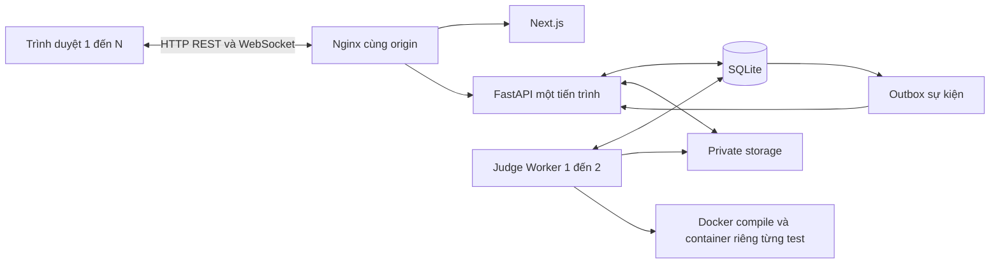

# LAN-LMS — Hệ thống học tập và thi lập trình trong mạng LAN

## 1. Project Information

- **Đề tài:** Thiết kế và xây dựng hệ thống LMS và thi lập trình trên mạng LAN theo mô hình Client–Server.
- **Topic:** Chủ đề 3 — Ứng dụng mạng; kết hợp hướng Networked Auto-Grader và hệ thống thi qua mạng.
- **Học phần:** Lập trình mạng, năm học 2026–2027.
- **Nhóm:** `[Điền số nhóm]`; **Giảng viên:** `[Điền họ tên]`.
- Bốn yêu cầu gốc: [Instruction](docs/requirements/Instruction.md), [README mẫu](docs/requirements/README_TEMPLATE.md), [Submission](docs/requirements/Submission.md), [Topics](docs/requirements/Topics.md).

| TV | Họ tên | MSSV | Email | Phần phụ trách |
|---|---|---|---|---|
| 1 | [Điền] | [Điền] | [Điền] | Backend nền tảng và tích hợp |
| 2 | [Điền] | [Điền] | [Điền] | Frontend và trải nghiệm người dùng |
| 3 | [Điền] | [Điền] | [Điền] | Database và nghiệp vụ LMS |
| 4 | [Điền] | [Điền] | [Điền] | Thi lập trình và judge |

## 2. Project Summary

**Problem:** Trong lớp thực hành, tài liệu, bài nộp, điểm danh và kết quả thi thường phân tán. Chấm chương trình ngay trong API còn khiến request bị chặn và khó phục hồi khi xử lý lỗi.

**Objectives:** Tập trung dữ liệu trên một máy chủ; phục vụ nhiều trình duyệt trong LAN; nhận bài bền vững; chấm C/C++/Java ngoài tiến trình API; trả trạng thái qua WebSocket và phục hồi bằng REST.

**Scope:** Trang chủ cho khách, khóa học, CSV tạo tài khoản, tài liệu, lịch/thông báo, điểm danh QR bằng camera/ảnh và chỉnh tay có mặt/đến muộn/vắng, bài tập file, giữa kỳ/cuối kỳ, test case, phiên thi, hàng đợi/worker, bảng điểm và backup/restore. Không gồm giám sát thi bằng webcam/ghi màn hình, phát hiện đạo văn code, bài nhiều file/project hoặc triển khai đa máy chủ.

## 3. System Overview

Giảng viên và sinh viên dùng trình duyệt. Máy chủ chạy Next.js, FastAPI, SQLite và private storage. Worker là tiến trình riêng; mỗi lần biên dịch/chạy chương trình dùng Docker Linux. Cài đặt lần đầu cần Internet; chạy trong LAN không dùng CDN hay dịch vụ QR bên ngoài sau khi đã có dependency và image.

| Vai trò | Chức năng |
|---|---|
| Khách | Xem trang chủ và danh mục; đăng nhập khi mở khóa học |
| Giảng viên | Khóa học, sinh viên, import, tài liệu, lịch, QR, bài tập/chấm tay, đề/test, theo dõi thi, trọng số, sửa điểm và nhập/xuất CSV |
| Sinh viên | Đổi mật khẩu, học liệu/lịch, điểm danh, nộp file, thi code, xem lịch sử và điểm riêng |
| Worker | Nhận job qua SQLite, biên dịch/chạy sandbox, ghi aggregate result và sự kiện |

## 4. System Architecture



API và worker cùng máy, cùng DB/storage; không đặt SQLite WAL trên network share. [Kiến trúc](docs/architecture.md) và [giao thức API](docs/api-specification.md) mô tả chi tiết.

## 5. Network Communication Design

- Browser → proxy: HTTP/1.1 REST, JSON hoặc multipart; cookie HttpOnly quản lý phiên. `/ws` nâng cấp WebSocket qua proxy.
- Ghi dữ liệu cần Origin hợp lệ và `X-CSRF-Token` từ `/api/auth/csrf`. Không có đăng ký công khai.
- `Idempotency-Key` bắt buộc cho confirm CSV/nộp file/gửi code: cùng key và body trả lại resource đã nhận; body khác trả 409.
- Submission và job được commit cùng transaction. Worker nhận job bằng khóa ghi ngắn, lease 60 giây, gia hạn mỗi 10 giây; attempt cũ không được ghi kết quả.
- Worker ghi sự kiện trong cùng transaction kết quả. API đọc outbox và gửi đúng chủ bài/giảng viên; mất WS thì REST là trạng thái chuẩn.
- Heartbeat 15 giây, ACK trong 10 giây. Frontend reconnect có backoff/jitter; bài chưa xong được kiểm tra lại mỗi 3 giây. Logout/đổi mật khẩu đóng kết nối đã thu hồi.
- Lỗi JSON gồm `detail`, `code`, `request_id`, `errors`; DB busy trả 503, dữ liệu sai 422/400, thiếu quyền 403, sai trạng thái/hết hạn 409.

Ví dụ kết quả:

```json
{"id":1,"status":"Accepted","verdict_code":"AC","score":100,"max_score":100,"version":4}
```

`score` trên submission là kết quả tổng của bài, **không phải điểm thi thang 10**. Điểm thi quy đổi từ số bài AC ở mục 12. Không lưu/trả kết quả từng test ẩn.

## 6. Technology Stack

| Thành phần | Công nghệ |
|---|---|
| Client | Next.js 16, React 19, TypeScript 6, Tailwind CSS 4 |
| API | Python 3.12, FastAPI, Pydantic, Uvicorn |
| DB | SQLite, SQLAlchemy 2.0.46, Alembic |
| Xác thực | Argon2id, server session, cookie HttpOnly, CSRF/Origin |
| Judge | Docker Linux, GCC/G++ C17/C++17, OpenJDK 17 |
| QR | qrcode 8.2 tạo SVG; ZXing Browser giải mã camera/ảnh ngay trong trình duyệt |
| Kiểm thử | pytest, httpx/TestClient, Docker thật, ESLint, TypeScript, production build |
| Tài liệu | Markdown, DOCX/PDF và biểu đồ từ số liệu thực nghiệm |

Phiên bản chính xác nằm trong `server/requirements.lock` và `client/package-lock.json`. Thư viện ngoài được khai báo trong các file này; không yêu cầu nhóm tự triển khai lại framework, compiler hoặc thuật toán hash.

## 7. Novelty and Contributions

Baseline thực nghiệm là **cùng pipeline với một worker**; phương án so sánh dùng **hai worker**. Đóng góp ở mức tích hợp: nhận bài và job nguyên tử, idempotency, lease và fencing khi phục hồi worker, kết hợp outbox/WebSocket với REST recovery. Không tuyên bố các cơ chế này là thuật toán mới trên thế giới.

| Nội dung | Bằng chứng |
|---|---|
| Retry không tạo bài trùng | Test API cùng/khác key và yêu cầu đồng thời |
| Worker lỗi không ghi đè kết quả mới | Test mất lease, attempt cũ, retry hết giới hạn |
| Tách xử lý nặng khỏi request | `judge/worker.py`, Docker và thực nghiệm 1/2 worker |
| Phục hồi trạng thái | REST snapshot và test thông báo worker → WS |

Giao diện được cải thiện để dễ sử dụng; không tính đổi màu/bố cục là đóng góp kỹ thuật.

## 8. Project Structure

```text
LAN-LMS/
├── client/                 # Next.js, giao diện teacher/student
├── server/app/             # API, auth, services và ORM
├── judge/                  # Queue, worker, compiler/sandbox
├── database/migrations/    # Alembic 0001–0004
├── database/seed/          # Dữ liệu giả lập tùy chọn
├── storage/                # File riêng tư; nội dung bị Git ignore
├── scripts/                # Cài/chạy, backup/restore, export, đóng gói
├── tests/                  # Unit và integration; Docker opt-in
├── experiments/            # Script đo, log thô và kết quả
├── statics/                # Sơ đồ, biểu đồ và dataset mẫu
├── docs/                   # Đặc tả, API, vận hành và yêu cầu gốc
└── REPORT/                 # Báo cáo DOCX/PDF và nguồn tạo
```

Giữ cấu trúc đã thống nhất của nhóm. Instruction.md cho phép thay đổi cây thư mục mẫu nếu dễ đọc và dễ chạy.

## 9. Requirements

- Python 3.12; Node.js 22 hoặc 24 và npm (bộ USB cần cùng major máy đóng gói).
- Windows với Docker Desktop dùng Linux engine/WSL2, hoặc Linux có Docker Engine.
- Nginx cho cùng origin trong LAN. Backend chỉ nghe loopback theo script mặc định.
- Database và storage nằm trên ổ đĩa cục bộ của máy chủ, đủ dung lượng bài nộp.
- Compiler container có giới hạn 768 MiB; run container theo cấu hình 64–1024 MiB. Số worker phải phù hợp RAM/CPU của máy.
- Docker phải báo được server khi chạy `docker info`; chỉ cài Docker CLI chưa đủ.

Môi trường đo và giới hạn kiểm chứng được ghi tại mục 13–16, không suy ra số máy vật lý từ số client mô phỏng.

## 10. Installation

Từ PowerShell tại thư mục repo:

```powershell
git clone --branch develop https://github.com/VQuyy-1458/LAN-LMS.git
cd LAN-LMS
.\scripts\setup_windows.ps1
cd client
npm ci
npm run build
cd ..
docker build -t lan-lms-judge:day25 judge
.\.venv\Scripts\python.exe -m server.app.seed
```

Seed teacher hỏi mật khẩu tương tác, không có mật khẩu mặc định. `setup_windows.ps1` tạo `.venv`, cài lockfile, tạo `server/.env` nếu chưa có và chạy migration.

Cài thủ công trên Linux:

```bash
python3.12 -m venv .venv
.venv/bin/python -m pip install -r server/requirements.lock
cp server/.env.example server/.env
.venv/bin/python -m alembic -c server/alembic.ini upgrade head
.venv/bin/python -m server.app.seed
cd client && npm ci && npm run build
cd ..
docker build -t lan-lms-judge:day25 judge
```

**Configuration:** Sửa `server/.env`, đặc biệt `ALLOWED_ORIGINS` thành origin web thật, ví dụ `http://192.168.1.10:8080`. `DATABASE_URL` là SQLite URL; đường dẫn tương đối tính từ gốc repo. `STORAGE_ROOT` tùy chọn, mặc định `storage/`; dùng đường dẫn tuyệt đối khi chạy nhiều tiến trình. `JUDGE_IMAGE` tùy chọn, mặc định `lan-lms-judge:day25`. Cookie Secure chỉ bật khi web chạy HTTPS.

Dữ liệu giả lập tùy chọn, **chỉ dùng DB demo**:

```powershell
.\.venv\Scripts\python.exe -m database.seed.seed_demo --teacher-username TEN_TAI_KHOAN_VUA_TAO
.\.venv\Scripts\python.exe -m database.seed.seed_content --teacher-username TEN_TAI_KHOAN_VUA_TAO
```

Seed đầu hỏi mật khẩu sinh viên giả lập; không thay mật khẩu tài khoản cũ. Seed nội dung thêm lịch/tài liệu/bài tập và hai đề nháp 5 bài, không tự mở thi. Giảng viên xem lại giờ thi/test trước khi lên lịch. CSV mẫu tải được ở màn import hoặc `client/public/samples/students.csv`.

## 11. Running the Project

**Chạy ngay trong LAN trên Windows:** nhấp đúp `CHAY_LAN.cmd`. Trình chạy tự chọn IP nếu chỉ có một kết nối LAN; nếu có nhiều kết nối, chọn mạng muốn dùng. Máy chủ mở localhost; cửa sổ in địa chỉ **HTTP cổng 8080** cho điện thoại. Sinh viên dùng **Chụp QR để điểm danh**, không cần cài chứng chỉ. HTTPS 8443 và trang /setup là tùy chọn cho quét video liên tục. Launcher dùng OpenSSL đi kèm Git for Windows (hoặc `OPENSSL_PATH`), tạo CA/chứng chỉ trong `.runtime/tls/` và không tự cài trust. Xem [camera Android/iPhone](docs/PHONE_CAMERA.md). Chỉ máy chủ chạy file; máy sinh viên chỉ cần trình duyệt. Máy chủ cần bật suốt thời gian sử dụng.

Trong VS Code, mở thư mục gốc project, chọn **Terminal → New Terminal** rồi chạy `./CHAY_LAN.cmd`. Không cần tự mở từng dịch vụ.

Nếu chỉ dùng trên máy này, nhấp đúp `CHAY_WEB.cmd` rồi chọn **1**. Nhấp đúp `DUNG_WEB.cmd` để dừng web; đóng cửa sổ launcher hay VS Code không dừng các dịch vụ đang chạy nền.

Cần hoàn tất cài đặt ở mục 10 một lần và có Nginx (trong PATH, `tools/nginx/nginx.exe`, hoặc biến `NGINX_PATH`). Giao diện tự build khi mã nguồn thay đổi; dịch vụ nền tự được khởi động lại khi code thay đổi. Dữ liệu demo hiện có trong `.runtime/web/demo.db` được giữ lại; nếu không có, dùng cấu hình `server/.env` và database thông thường. Launcher không đặt lại dữ liệu. Khi có Docker CLI, worker chạy nền và chờ Engine/image; không tiêu hao lượt chấm khi Engine chưa sẵn sàng. Mở Docker Desktop, chờ Linux Engine, chạy **BAT_BO_CHAM.cmd** để chuẩn bị image. Mục Thi lập trình hiển thị worker đang hoạt động và số bài chờ.

Chế độ LAN chỉ mở proxy trên IP mạng được chọn. Nếu firewall chặn, cần cho phép Nginx nhận TCP 8080/8443 từ mạng lớp học một lần; launcher không tự thay đổi firewall hay loại mạng. API và frontend nội bộ vẫn dùng loopback.

Khi cần xem log trực tiếp hoặc phát triển, có thể mở các terminal riêng từ gốc repo trên Windows:

```powershell
# 1 — API
.\scripts\start_server.ps1
# 2 — Frontend production
.\scripts\start_client.ps1
# 3 — Judge worker
.\scripts\start_worker.ps1
# 4 — Proxy, đường dẫn tới nginx.exe đã cài
.\scripts\start_proxy.ps1 -NginxPath 'C:\tools\nginx\nginx.exe'
```

`start_client.ps1` mặc định chạy production sau khi đã build; khi phát triển dùng `scripts/start_client.ps1 -Dev`. Proxy mặc định cổng 8080, API 8000, client 3000. Có thể mở terminal worker thứ hai với `--worker-id worker-2`. Chỉ chạy **một Uvicorn worker** vì hub WS nằm trong tiến trình; judge workers độc lập.

Trên Linux, dùng venv tương ứng và chạy:

```bash
.venv/bin/python -m uvicorn server.app.main:app --host 127.0.0.1 --port 8000 --workers 1 --proxy-headers --forwarded-allow-ips 127.0.0.1 --ws-max-size 4096
npm --prefix client run start
.venv/bin/python -m judge.worker --worker-id worker-1
nginx -c /absolute/path/to/LAN-LMS/scripts/nginx.conf
```

**Multiple clients:** Các máy cùng LAN mở `http://IP_MAY_CHU:8080`, dùng tài khoản riêng. Không điền localhost của máy sinh viên vào địa chỉ máy chủ. Kiểm tra từ mỗi máy:

```powershell
.\.venv\Scripts\python.exe -m scripts.check_lan --base-url http://IP_MAY_CHU:8080 --username MA_SINH_VIEN
```

**Tests:**

```powershell
.\.venv\Scripts\python.exe -m pytest -q
$env:RUN_DOCKER_TESTS='1'
.\.venv\Scripts\python.exe -m pytest -q
npm --prefix client run typecheck
npm --prefix client run lint
npm --prefix client run build
```

Không đặt `RUN_DOCKER_TESTS=1` khi engine/image chưa sẵn sàng. Các test Docker không chạy sẽ được báo skipped; skipped không đồng nghĩa đã nghiệm thu Docker Windows. [CI thật](https://github.com/VQuyy-1458/LAN-LMS/actions) chạy image và toàn bộ test trên Linux.

## 12. Main Features

- Cả hai vai trò chọn khóa học trước; menu chung chỉ có Tổng quan/Khóa học. Tài liệu, lịch, điểm danh, bài tập, kỳ thi và điểm nằm trong khóa đã chọn. URL giữ course/tab khi tải lại hoặc quay lại.
- Có [khóa thực hành mạng](demo/README.md) gồm 2 kỳ thi, 10 bài và 62 test; script seed idempotent giữ nguyên dữ liệu có sẵn.
- Teacher tạo/sửa khóa, import CSV UTF-8/BOM theo preview → confirm, tạo tài khoản mới với mật khẩu DOB DDMMYYYY và bắt buộc đổi; giữ mật khẩu tài khoản cũ.
- Tài liệu riêng tư; file/ZIP tối đa 20 MiB, tên lưu UUID, không giải nén/thực thi file upload.
- Lịch học, hạn nộp, lịch thi và thông báo; dashboard đọc dữ liệu thật.
- Tạo QR từ lịch học; sinh viên quét camera hoặc ảnh QR để tự gửi điểm danh, không phải chọn buổi hoặc nhập mã thủ công. Token ngẫu nhiên 60–3600 giây; chống trùng; giảng viên đánh dấu trực tiếp có mặt/đến muộn/vắng cho toàn bộ danh sách lớp, có audit. Token chỉ trả khi tạo phiên, DB chỉ lưu hash. Đến muộn hiện được tính là có tham gia khi tính chuyên cần.
- Bài tập file có deadline, cho phép nộp lại theo cấu hình, lưu lịch sử và chấm tay 0–10/feedback. Bản nộp cuối hợp lệ là bản hiệu lực để tính homework.
- Mỗi khóa có nhiều đề test/giữa kỳ và tối đa một cuối kỳ. Giữa kỳ lấy trung bình các đề được chọn. Giảng viên cấu hình số bài qua bảng quy đổi, mặc định `[0,5,7,8,9,10]` cho đề 5 bài.
- Thi code có Pending/Compiling/Running rồi **AC, WA, CE, TLE, MLE, RTE, SE**. C17/C++17/Java17, stdin/stdout hoặc file I/O. Java dùng public class Main, không package.
- Chỉ bài **AC toàn bộ test** được tính là đã giải; một bài có nhiều AC vẫn tính một lần. Lần sai sau AC không làm mất bài đã giải. Mặc định 0/1/2/3/4/5 bài AC → 0/5/7/8/9/10 điểm thi. Không cộng điểm test lẻ vào điểm thi.
- Chuyên cần = 10 × số phiên có mặt / số phiên đã đóng; homework trung bình bản nộp cuối của các bài đã hết hạn, thiếu bài nộp tính 0 sau hạn, chưa chấm thì null. Không có phiên/bài đã đóng thì null.
- Trọng số mặc định 10/10/10/70 cho chuyên cần/bài tập/giữa kỳ/cuối kỳ; teacher sửa, tổng phải 100. Thành phần trọng số 0 được bỏ qua; thiếu điểm ở thành phần trọng số dương thì tổng null. Làm tròn cuối cùng hai chữ số.
- Sửa điểm trực tiếp không cần lý do, có audit; điểm override để trống trả về tính tự động. Student chỉ xem dòng của mình và nhận cập nhật trực tiếp. Xuất CSV BOM có chống công thức; import cột mã dạng Text để giữ số 0 đầu.

## 13. Experimental Setup

Thực nghiệm HTTP dùng Windows, Intel Core i5-12500H, 16 CPU logic, 15,73 GiB RAM; client mô phỏng trên cùng máy, HTTP trực tiếp Uvicorn qua loopback. Không gồm Nginx/TLS/Wi-Fi hoặc thời gian chấm. Mỗi client có tài khoản/session riêng, thực hiện xem course → xem đề → gửi code; login/CSRF/session-start/warm-up không nằm trong latency được báo cáo.

Thực nghiệm judge chạy trong một GitHub Actions Linux runner; cùng image/dataset và fresh DB cho từng lần chạy; 20 bài C/C++/Java, một test/bài, mỗi bài thứ tư chờ 1 giây, giới hạn 3000 ms/256 MiB. Một/hai worker, mỗi cấu hình ba lần. Wall time compile/run gồm overhead Docker; `busy_time_ratio` là độ bận theo thời gian, không phải CPU utilization.

```powershell
.\.venv\Scripts\python.exe -m experiments.run_network --output .runtime/network-measurements
.\.venv\Scripts\python.exe -m experiments.run_judge --output .runtime/judge-measurements --trials 3 --jobs 20
```

Script tự tạo dữ liệu giả lập biệt lập và dọn tiến trình của nó. Lệnh thứ hai cần Docker thật. Log đã đo nằm trong [experiments/results](experiments/results/); xem [phân tích kết quả](experiments/RESULTS.md).

## 14. Experimental Results

Kết quả chức năng, hiệu năng, raw CSV/JSON và nguồn CI được ghi tại [experiments/RESULTS.md](experiments/RESULTS.md). Chỉ sử dụng số đo thật. Không đổi lỗi hệ thống judge thành AC hoặc số liệu giả để demo.

## 15. Discussion

Hai worker giảm hàng đợi và tăng throughput trên bộ bài mẫu đã đo, nhưng không chứng minh khả năng tăng tuyến tính trên mọi đề/máy. Request đồng thời vẫn tranh khóa ghi SQLite; p95 tăng khi tải cao. Thử nghiệm HTTP loopback không đại diện độ trễ Wi-Fi hay nhiều máy vật lý. Compiler/container startup là phần đáng kể của wall time.

## 16. Limitations

- Chưa có bằng chứng nghiệm thu **hai máy vật lý LAN** trong phiên làm việc này.
- Docker Desktop Windows đã phục hồi ngày 26/10/2026 sau khi khởi động lại WslService và cập nhật WSL 2.6.3 lên 3.0.3 (kernel 6.18.54.1). Bộ 90 test có Docker thật đã qua trên Windows; một bài mẫu nộp qua web được worker chấm AC và cập nhật điểm. Nghiệm thu nhiều máy LAN vẫn là bước riêng.
- Một API process, SQLite một writer; không phải kiến trúc phân tán hay triển khai production Internet nhiều node.
- Docker giảm quyền và giới hạn tài nguyên nhưng không được mô tả an toàn tuyệt đối. API/worker không dành cho môi trường hostile multi-tenant quy mô lớn.
- HTTP LAN demo không mã hóa nội dung truyền; HTTPS cần được cấu hình khi dùng dữ liệu thật ngoài môi trường thử tin cậy.
- QR có thể được chia sẻ; không chứng minh vị trí tuyệt đối. Camera trực tiếp cần HTTPS tin cậy hoặc localhost; LAN HTTP dùng chụp/chọn ảnh QR hoặc nhập mã. Xem [hướng dẫn LAN](docs/lan-deployment.md).
- Không có cơ chế kiểm tra đạo văn code, giám sát màn hình, bài nhiều file hoặc khôi phục bản nháp từ thiết bị khác.
- Thông tin nhóm, đóng góp cá nhân và Compilatio do nhóm hoàn thiện bằng dữ liệu thật.

## 17. Future Work

Đo trên LAN nhiều máy thực, HTTPS, mở rộng storage/DB khi tải tăng, pub/sub cho nhiều API process, tối ưu độ trễ chấm, tăng bộ thử sandbox và hỗ trợ project nhiều file theo một đặc tả riêng.

## 18. Report

Báo cáo trong `REPORT/`, gồm `NhomXX_LANLMS_Report.docx` và bản PDF để đọc. Cấu trúc technical paper theo Instruction.md. Nguồn tạo và số liệu đi cùng repo. Thay XX và điền thông tin nhóm trước khi nộp; nhóm cần đọc, kiểm chứng và giải thích được mã nguồn.

Kiểm tra Compilatio bằng tài khoản học phần, sử dụng kết quả thật; không tự ghi đã đạt ngưỡng khi chưa kiểm tra.

## 19. References

1. [FastAPI WebSockets](https://fastapi.tiangolo.com/advanced/websockets/).
2. [SQLite Write Ahead Logging](https://www.sqlite.org/wal.html) và [Backup API](https://www.sqlite.org/backup.html).
3. [Docker resource constraints](https://docs.docker.com/engine/containers/resource_constraints/).
4. [DOMjudge manual](https://www.domjudge.org/docs/manual/main/index.html), tham khảo kiến trúc server/judgehost và luồng submission; không kế thừa mã nguồn DOMjudge.
5. [Tài liệu giảng viên](docs/requirements/), đặc tả [PROJECT_PLAN.md](docs/PROJECT_PLAN.md) và [API](docs/api-specification.md).

## 20. Team Contribution

| Thành viên | Nội dung thực tế cần nhóm xác nhận | Tỷ lệ |
|---|---|---|
| 1 | Auth, network, tích hợp và đóng gói | [Điền]% |
| 2 | Frontend, UI/REST/WS và nghiệm thu | [Điền]% |
| 3 | Database, LMS, điểm và backup | [Điền]% |
| 4 | Exam, queue/worker và sandbox | [Điền]% |
| Tổng cần đạt | Ghi theo đóng góp thực tế, không chỉ dựa vào kế hoạch | 100% |

Có dùng AI hỗ trợ thiết kế, lập trình, kiểm thử và tài liệu. Nhóm chịu trách nhiệm kiểm chứng, trích dẫn, khai báo đóng góp và giải trình phần nộp; không tự coi công cụ AI là đóng góp cá nhân của một sinh viên.

## 21. Demo

1. Khởi động API/client/worker/proxy; mở cùng origin ở teacher và student.
2. Teacher tạo khóa, preview/confirm CSV; student mới đăng nhập và đổi mật khẩu.
3. Teacher đăng tài liệu/lịch; mở QR; student tải tài liệu, điểm danh, nộp file.
4. Teacher tạo giữa kỳ/cuối kỳ, đặt bảng quy đổi, thêm đủ bài và test; kiểm tra/lên lịch mở.
5. Student vào phiên, gửi code đúng/sai/lỗi; quan sát Pending → chấm → AC/WA/… và lịch sử. Ngắt/kết nối lại browser rồi lấy trạng thái đã lưu.
6. Teacher theo dõi phiên, chấm file, cấu hình trọng số và công bố; student chỉ thấy điểm của mình. Xuất CSV.
7. Chạy test retry/lease và xem benchmark; trình bày backup/restore trên bản sao.

## 22. Submission

Theo Submission.md: báo cáo Compilatio tên `NhomXX_LANLMS_Report.docx`, source tên `NhomXX_LANLMS_Source`, thư mục bàn giao `NhomXX_LANLMS/Source/` và `Report/`. Hạn ghi trong yêu cầu: **23:59 ngày 31/10/2026 giờ Việt Nam**. Submission.md hướng dẫn bàn giao USB qua lớp trưởng; Instruction/README mẫu còn nhắc Drive, nhóm xác nhận thông báo nộp cuối cùng của giảng viên. GitHub phục vụ quản lý phiên bản, không thay thế hình thức nộp.

```powershell
.\.venv\Scripts\python.exe -m scripts.package_submission --group XX --output .runtime/delivery
```

Thay XX bằng số nhóm thật khi đã có. Gói chỉ lấy file đã commit, không lấy `.env`, `.git`, `.venv`, `node_modules`, `.next`, DB/upload/log/backup riêng tư. Sau khi sửa thông tin báo cáo, commit lại trước khi đóng gói.

Backup và restore (nên dừng API/worker trước):

```powershell
.\.venv\Scripts\python.exe -m scripts.backup_database backup --database database/lan_lms.db --storage storage --output .runtime/backups/snapshot-01
.\.venv\Scripts\python.exe -m scripts.backup_database verify .runtime/backups/snapshot-01
.\.venv\Scripts\python.exe -m scripts.backup_database restore .runtime/backups/snapshot-01 --database .runtime/restored/lan_lms.db --storage .runtime/restored/storage
```

Restore yêu cầu đích mới, kiểm tra checksum/integrity/FK, thu hồi session và trả job đang chạy về pending. Không tự ghi đè DB/storage đang dùng. Trỏ `DATABASE_URL`/`STORAGE_ROOT` sang đích phục hồi rồi chạy migration/kiểm tra trước khi dùng; backup có dữ liệu riêng tư, không đẩy lên Git.

## 23. Final Verification

- [x] Có mã nguồn client/server/queue/worker và private storage.
- [x] Có auth, quyền, retry, error handling và test tự động.
- [x] Có Docker CI thật và production frontend build.
- [x] Có thực nghiệm và raw logs tái lập, không bịa số liệu.
- [x] Có README theo cấu trúc mẫu và báo cáo theo technical paper.
- [ ] Điền số nhóm, thành viên, giảng viên, tỷ lệ đóng góp thực tế.
- [ ] Nghiệm thu Docker Windows và ít nhất hai máy LAN vật lý.
- [ ] Kiểm tra Compilatio theo quy định, lưu kết quả thật.
- [ ] Đọc lại bản cuối, thử cài trên máy demo và xác nhận nơi nộp.

Các ô chưa tick là bước nghiệm thu/hành chính cần bằng chứng, không được suy ra từ code hoặc CI.

## 24. Contact

Nhóm tự điền đầu mối liên hệ và giảng viên ở mục 1. Không có hotline/thông tin tổ chức giả được cấu hình trong ứng dụng.


Quy định mới và chuyển khóa học/USB ngày 27/10: xem [CHANGES_20261027.md](docs/CHANGES_20261027.md).


Hai khóa học có 40 tài khoản mẫu, PDF tự soạn, assignment có file đề, nhập testcase ZIP và ví dụ công khai: xem [CLASSROOM_DEMO.md](docs/CLASSROOM_DEMO.md). Migration 0006 thêm file đề assignment; gói chuyển khóa phiên bản 1 cũ vẫn được đọc với attachment rỗng.

### Lịch tuần, điểm danh và tài khoản sinh viên

Hai khóa thực hành dùng mã LTM-2026-01 và CTDL-2026-01, mỗi khóa 20 sinh viên, 12 buổi học, 4 thông báo, 6 bài tập và 4 đề lập trình. Danh sách sinh viên của giảng viên có ngày sinh DD/MM/YYYY. Tài khoản tạo mới qua CSV dùng mật khẩu ngày sinh DDMMYYYY và bắt đổi ở lần đăng nhập đầu. Xem [hướng dẫn dữ liệu lớp](docs/CLASSROOM_DEMO.md) và file thông tin cấp tài khoản riêng trong `.runtime/classroom-20261027/accounts.csv`; không commit thông tin đăng nhập.

Sinh viên chỉ mở camera/quét QR để điểm danh; giảng viên chọn buổi học và xem cập nhật danh sách. Các bộ lọc bài tập đếm toàn bộ dữ liệu trước phân trang. Tổng quan có lịch tuần, lịch tháng và hoạt động; danh sách khóa học nằm ở mục Khóa học.

## Phòng thi, điểm danh và bảng điểm

Đã bổ sung phòng thi riêng, phiên đăng nhập theo tab, điểm danh bằng hộp thoại QR, tiến độ bài tập chỉnh sửa tại bảng, nhập/xuất CSV và điểm sinh viên cập nhật trực tiếp. Chuyên cần mặc định 10, trừ 1 mỗi buổi vắng. Xem [quy trình sử dụng và giới hạn định dạng xem trước](docs/PRACTICAL_WORKFLOWS.md).

## Cập nhật vòng đời và dữ liệu 28/10/2026

Quy tắc mới thay thế phần hướng dẫn cũ về mở lại đề, chỉnh điểm danh lịch sử và hủy tổng kết. Khóa đã chốt chỉ được xem/xuất; phiên điểm danh đã chốt không sửa hay tạo lại; danh sách phân trang 10 mục. Xem [hướng dẫn hiện hành và tài khoản bộ dữ liệu mới](docs/LIFECYCLE_AND_DATA.md).
