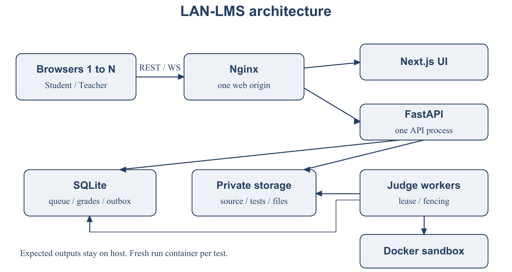
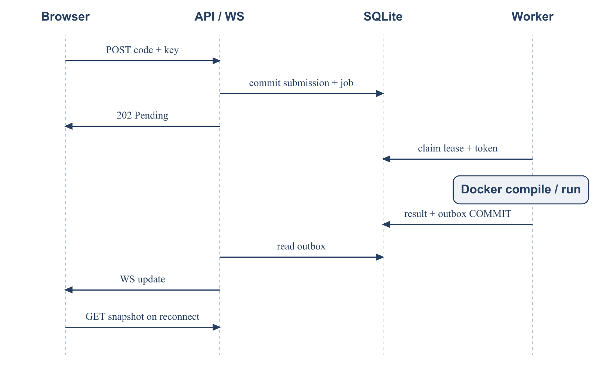
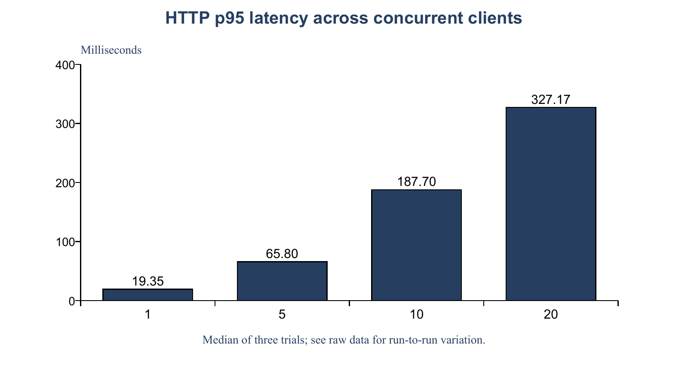
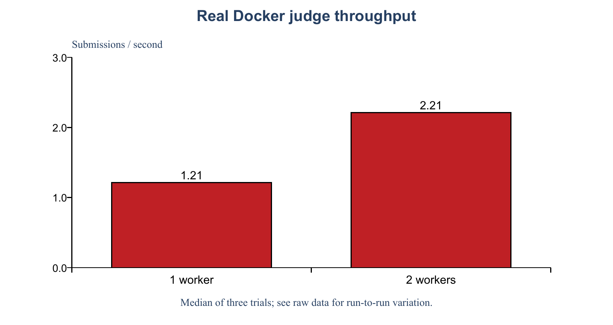

# Hệ thống học tập và thi lập trình trong mạng LAN

Báo cáo bài tập lớn Lập trình mạng năm học 2026 đến 2027

Nhóm [điền số nhóm]   Giảng viên [điền họ tên]

| Thành viên | Họ tên | MSSV | Email |
|---|---|---|---|
| 1 | [Điền] | [Điền] | [Điền] |
| 2 | [Điền] | [Điền] | [Điền] |
| 3 | [Điền] | [Điền] | [Điền] |
| 4 | [Điền] | [Điền] | [Điền] |

Tháng 10 năm 2026

<!-- pagebreak -->

## 1 Abstract

LAN-LMS giải quyết việc quản lý học liệu, bài nộp và thi lập trình trong một lớp học sử dụng mạng LAN. Hệ thống tổ chức theo Client–Server, dùng REST cho nghiệp vụ và WebSocket cho thay đổi trạng thái. FastAPI nhận source, lưu submission và job nguyên tử trong SQLite, sau đó worker độc lập biên dịch và chạy C17, C++17 hoặc Java17 trong Docker Linux. Queue có lease và attempt token để phục hồi khi worker dừng, đồng thời ngăn kết quả cũ ghi đè kết quả của attempt mới. Điểm thi quy đổi từ số bài AC theo bảng giảng viên cấu hình. Thực nghiệm HTTP gồm 324 request đo với 1, 5, 10 và 20 client mô phỏng, không ghi nhận lỗi trong bộ đo. Trên cùng runner Linux và bộ 20 submission mỗi lượt, trung vị throughput của hai worker bằng 1.82 lần một worker qua ba lần chạy. Kết quả hỗ trợ tính khả thi của thiết kế trong phạm vi thử nghiệm; chưa chứng minh khả năng phục vụ quy mô lớn hoặc thay thế nghiệm thu hai máy vật lý LAN.

## 2 Keywords

Client Server; REST; WebSocket; durable queue; programming judge; fault recovery.

## 3 Introduction

Lớp thực hành lập trình cần tập hợp tài liệu, danh sách sinh viên, bài tập và kết quả thi tại một nơi. Nếu xử lý compiler và chương trình sinh viên ngay trong request, một bài chạy lâu có thể giữ tài nguyên API, gây timeout và làm người dùng không biết bài đã được nhận hay chưa. Khi nhiều sinh viên gửi cùng lúc, thao tác gửi lại còn có thể tạo bài trùng.

Mục tiêu của LAN-LMS là tách nhận bài khỏi chấm bài, lưu trạng thái đủ để khôi phục sau mất kết nối và cung cấp giao diện thống nhất cho giảng viên và sinh viên. Đề tài thuộc Chủ đề 3 Ứng dụng mạng, kết hợp định hướng Networked Auto-Grader và thi qua mạng trong tài liệu học phần [1]. Trọng tâm là giao tiếp giữa browser, API, database và worker; giao diện/database hỗ trợ luồng đó.

Phạm vi gồm auth, khóa học, CSV tạo tài khoản, tài liệu, lịch/thông báo, QR, bài tập file, giữa kỳ/cuối kỳ, hàng đợi chấm, bảng điểm và backup. Hệ thống không giám sát webcam, màn hình hoặc bàn phím, không phát hiện đạo văn code và không chạy bài project nhiều file. Các quyết định nghiệp vụ được chốt trong đặc tả 1.2 của repository.

## 4 Background and Related Work

REST phù hợp các thao tác lấy dữ liệu, upload và thay đổi tài nguyên có phản hồi rõ ràng. WebSocket bổ sung kết nối hai chiều lâu dài để thông báo mà không chờ người dùng tải lại trang. FastAPI hỗ trợ WebSocket và cơ chế dependency của ứng dụng [2]. Trong LAN-LMS, WS báo thay đổi, còn REST snapshot giúp phục hồi khi sự kiện bị mất; hai kênh không thay thế lẫn nhau.

DOMjudge tổ chức server quản lý cuộc thi và judgehost xử lý submission [5]. Đề tài tham khảo sự phân tách vai trò này nhưng không kế thừa source code DOMjudge. Phạm vi LAN-LMS gộp LMS và thi lớp học, dùng chính sách điểm theo số bài AC do giảng viên chọn; không phải bản tái hiện đầy đủ một hệ thống thi đấu quy mô lớn.

SQLite WAL cho phép reader và writer hoạt động đồng thời trong nhiều tình huống, nhưng vẫn có giới hạn writer và yêu cầu cùng host khi chia sẻ WAL [3]. Docker cho phép đặt CPU và memory constraints; mặc định container không tự có mọi giới hạn tài nguyên [4]. Ứng dụng vì vậy chủ động cấu hình khóa, busy timeout, quyền, volume và giới hạn thay vì coi việc sử dụng thư viện là đủ.

## 5 Problem Definition

Input gồm tài khoản, CSV sinh viên, nội dung khóa học, file học liệu/bài tập, đề và test case, source code, thời gian/tài nguyên và trọng số. Output là tài nguyên theo quyền, lịch sử nhận bài, trạng thái chấm, số bài AC, điểm công bố, CSV điểm và snapshot backup có thể phục hồi.

Mạng được giả định là LAN với một máy chủ lưu database và private storage trên ổ đĩa cục bộ. Browser là client không tin cậy: không được quyết định quyền, deadline hoặc điểm. Đồng hồ máy chủ quyết định thời hạn. Source và test là dữ liệu không tin cậy; expected output không được đưa vào container của chương trình sinh viên.

Các ràng buộc là không mất bài đã được server xác nhận, không tạo resource trùng khi retry cùng key, không lộ test/source của người khác và chỉ chấp nhận kết quả từ attempt đang sở hữu job. Việc thực thi có thể lặp lại sau crash; thiết kế không tuyên bố exactly once execution.

## 6 Proposed Approach

Request gửi code có cookie, CSRF token và Idempotency-Key. API kiểm tra role/enrollment, phiên, giờ thi, ngôn ngữ và giới hạn source trước khi tạo bài. Khóa ghi ngắn tuần tự hóa việc đánh số attempt và kiểm tra key. Source, submission, job và bản ghi replay được hoàn tất trước phản hồi 202. Gửi lại cùng key/body trả resource đã nhận; body khác trả xung đột.

Worker lấy job pending hoặc running đã hết lease trong một transaction. Claim tạo token mới, tăng attempt_count và đặt lease 60 giây. Một thread gia hạn mỗi 10 giây trong lúc compiler/test chạy. Khi ghi tiến độ hoặc kết quả, worker phải khớp job, token, trạng thái running và lease chưa hết. Sau ba attempt không thành công, job thành System Error để người vận hành xử lý, không treo vô hạn hoặc trả kết quả giả.

```text
BEGIN IMMEDIATE
chọn job pending hoặc lease hết hạn
nếu quá số attempt thì ghi System Error
ngược lại tạo token và lease rồi COMMIT
biên dịch và chạy test ngoài transaction
BEGIN IMMEDIATE
chỉ ghi result và outbox nếu token vẫn sở hữu
COMMIT
```

Với một sinh viên và kỳ thi, tập bài giải đúng gồm các problem có ít nhất một submission AC hợp lệ trước hạn của phiên. Điểm thi bằng score_ladder tại chỉ số là số phần tử của tập này. Mặc định 0, 1, 2, 3, 4, 5 bài AC tương ứng 0, 5, 7, 8, 9, 10 điểm. Lần sai sau AC không xóa kết quả; không cộng điểm test lẻ vào điểm thi.

## 7 System Architecture



Nginx cung cấp một origin để browser gọi web, API và WS cùng domain/port. Next.js hiển thị và gửi yêu cầu. FastAPI giữ auth, quyền và nghiệp vụ; SQLite lưu metadata và queue; private storage giữ file. Worker dùng cùng DB/storage nhưng là tiến trình riêng. Chỉ một API process vì hub WS nằm trong bộ nhớ tiến trình; một/hai worker có thể nhận job độc lập.

Dữ liệu chia thành auth, hồ sơ/khóa, học liệu/lịch/CSV, điểm danh/bài tập, thi/judge, điểm/audit và outbox. User ID khác profile Student/Teacher ID. Access service xử lý quan hệ này tập trung, tránh kiểm tra quyền bằng một ID tình cờ trùng. Test ẩn và file nộp không được public serve.

## 8 Network Communication Design



REST dùng JSON snake_case; upload multipart và download attachment có quyền. Timestamp có múi giờ. Response phân trang có items, page, page_size và total. Lỗi chuẩn có detail, code, request_id và errors để liên kết lỗi client với log mà không ghi mật khẩu hoặc payload nhạy cảm.

Session nằm server, cookie HttpOnly/SameSite Lax, thời hạn tám giờ. Origin allowlist và CSRF bảo vệ ghi dữ liệu; mật khẩu hash Argon2id. Mật khẩu DOB chỉ dùng ban đầu theo yêu cầu CSV và phải đổi trước nghiệp vụ. Logout thu hồi session tương ứng; đổi mật khẩu thu hồi mọi session và WS liên quan.

```json
{
  "event_id": "opaque-id",
  "type": "submission.updated",
  "occurred_at": "2026-10-25T08:00:00Z",
  "data": {"submission_id": 1, "status": "Accepted", "version": 4}
}
```

WS xác thực trước accept, không nhận token phiên qua query hoặc quyền subscribe course do client tự khai. Heartbeat 15 giây, ACK trong 10 giây, queue tối đa 100 message/connection. Worker ghi outbox cùng transaction kết quả; API đọc và chọn owner/teacher từ DB. Sau reconnect, browser lấy REST snapshot và tiếp tục polling nếu cần. Event không cam kết replay; mất WS không xóa submission.

| Tình huống | Phản hồi và phục hồi |
|---|---|
| Input sai hoặc thiếu quyền | 400/422 hoặc 403, không ghi resource |
| Gửi lại request đã nhận | Cùng key/body replay; khác body 409 |
| Hết giờ hoặc đã finish | 409 cho bài mới, không tin timestamp browser |
| DB busy hoặc queue đầy | 503/429; retry có kiểm soát |
| Worker chết hoặc mất lease | Nhận lại job; attempt cũ không ghi kết quả |
| WS mất kết nối | Reconnect và GET snapshot, giữ bài đã nhận |
| Docker không sẵn sàng | Retry hữu hạn rồi SE; không giả AC |

## 9 Implementation

Backend chia core, modules, schemas và services dùng chung. Course/CSV kiểm tra owner/enrollment từ DB. Preview hết hạn 15 phút; bất kỳ lỗi, mã trùng hoặc xung đột nào ngăn toàn bộ confirm. Confirm và idempotency commit cùng accounts/profile/enrollment. Tài khoản cũ giữ nguyên mật khẩu. File 20 MiB lưu dưới UUID, chỉ download qua API; ZIP không giải nén hoặc thực thi.

Điểm danh dùng token ngẫu nhiên hữu hạn, DB chỉ lưu hash. QR SVG tạo trên server, không gửi token tới dịch vụ ngoài. Unique session/student và transaction ngăn check-in trùng. Teacher chỉnh present/absent cần lý do và audit. Lịch gồm lesson, exam, deadline và announcement; dashboard lấy lịch và số liệu thật.

Đề có draft và scheduled; upcoming/open/ended tính từ server. Mỗi course tối đa một midterm và một final. Trước khi lên lịch cần đủ N bài theo ladder, có test và tổng trọng số khớp. Khi tới giờ hoặc có phiên, đề/test bị khóa. Nhiều tab tái sử dụng một session; finish ngăn bài mới nhưng bài đã nhận vẫn được chấm.

Docker runner compile một lần và chạy mỗi test trong container mới. Container dùng user 65534, network none, read-only root, drop capabilities, no-new-privileges, CPU/pids/RAM/swap/tmpfs/time/output/file limits. Compiler chỉ thấy source và artifacts riêng; chương trình chỉ thấy artifacts/input, không thấy expected output hoặc DB. Java Main không package, heap cap 128 MiB bổ sung trần toàn container. Exact so bytes; normalized đổi CRLF sang LF, bỏ space/tab cuối dòng và newline cuối, giữ trắng đầu dòng/nội bộ.

Bảng điểm tính tại server. Chuyên cần dựa trên phiên đóng; homework dùng bản nộp cuối của bài đã hết hạn. Không nộp sau hạn tính 0, có nộp chưa chấm thì null. Thiếu điểm ở trọng số dương làm total null; trọng số 0 bỏ qua. Override cần lý do; đổi nguồn thu hồi công bố. Student chỉ thấy dòng của mình khi công bố; CSV BOM escape ô có thể là công thức.

Backup dùng SQLite backup API khi giữ writer reservation, rồi copy storage và tạo manifest SHA-256. Restore xác minh checksum/integrity/FK vào đích mới, thu hồi session và trả job running về pending. Nên dừng API/worker trước backup lớn để tránh tranh khóa và hết lease. Gói nộp lấy file đúng commit, không lấy .env, DB, upload, cache hoặc secret.

## 10 Experimental Setup

HTTP đo trên Windows-11-10.0.26300-SP0, Intel Core i5-12500H, 16 CPU logic và 15,73 GiB RAM. Uvicorn chạy trực tiếp qua TCP loopback; latency không gồm Nginx, TLS hoặc Wi-Fi. Từng client có account/session riêng. Mỗi lượt thực hiện GET courses, GET problems và POST code. Login, CSRF, session start và health warm-up không tính vào số đo. Các mức 1/5/10/20 client, ba lần mỗi mức, tổng 324 request đo; không chạy judge trong phép đo HTTP.

Judge đo trên cùng GitHub Actions runner: Linux-6.17.0-1022-azure-x86_64-with-glibc2.39; AMD EPYC 9V45 96-Core Processor; 4 CPU logic; 15.61 GiB RAM; Python 3.12.15; Docker 28.0.4. Mỗi lượt có 20 chương trình sum C/C++/Java; một test/chương trình, mỗi bài thứ tư chờ một giây để tạo tải hỗn hợp. Giới hạn 3000 ms/256 MiB, fresh DB từng lượt, một/hai worker và ba lượt mỗi cấu hình. Không so số HTTP Windows với judge Linux để kết luận hiệu năng giữa hai hệ điều hành.

Metric gồm latency HTTP, p50/p95, error rate và request throughput; queue wait từ nhận bài tới claim, compile/run wall time, end-to-end tới commit kết quả và submission throughput. busy_time_ratio là độ bận theo wall clock, không phải CPU utilization. Bảng báo trung vị của ba thống kê mỗi lượt, không gộp thành một ước lượng độ tin cậy. P95 từng lượt dùng nearest-rank; p50 dùng median trong thư viện chuẩn.

## 11 Results

Test bao phủ auth/quyền, CSRF/Origin, CSV lỗi/hết hạn/đồng thời, private file, deadline, QR trùng, đề/phiên/test ẩn, idempotency, lease/fencing/retry, AC ladder/công bố, migration và backup. CI Linux chạy compiler thật cho C/C++/Java stdio/file, verdict/limits, file/network/nonroot probes và API tới worker. Bằng chứng CI/raw benchmark có commit/run/artifact. Các ca Docker bỏ qua ở Windows không được tính là đã chạy trên Windows.

| Client đồng thời | p50 ms | p95 ms | Request mỗi giây | Request đo | Lỗi |
|---|---|---|---|---|---|
| 1 | 7.36 | 19.35 | 80.56 | 9 | 0% |
| 5 | 35.56 | 65.80 | 107.94 | 45 | 0% |
| 10 | 66.21 | 187.70 | 86.86 | 90 | 0% |
| 20 | 137.39 | 327.17 | 87.56 | 180 | 0% |



Không có lỗi HTTP trong bộ đo, nhưng p95 tăng theo tải và biến động giữa ba lượt. Điều này không chứng minh hệ thống không lỗi ngoài dataset hoặc ở tải cao hơn. Tất cả 120 submission trong sáu lượt judge đều AC, phù hợp bộ chương trình/test đã thiết kế.

| Worker | Wall time s | Bài mỗi giây | p50 chờ s | p50 tổng s |
|---|---|---|---|---|
| 1 | 16.47 | 1.214 | 8.77 | 9.20 |
| 2 | 9.04 | 2.211 | 4.04 | 5.08 |



Trong môi trường này, hai worker đạt throughput gấp 1.82 lần một worker. Raw log giữ từng job, ngôn ngữ, verdict, attempt, compile/run/queue/end-to-end. Nguồn: https://github.com/VQuyy-1458/LAN-LMS/actions/runs/40202701438. Commit 8ed2c140e70bba601c46566a315e09843adc1060. Image sha256:7a4236248acc1d9a3793c04b87b3e264a1e477e6e2395a28f7dec97e50a18f21.

## 12 Discussion

Kết quả phù hợp việc đưa compiler/runtime ra ngoài request: API có thể nhận bài trước khi chấm xong. Idempotency giải quyết tình huống browser không biết server đã nhận hay chưa. Lease cho phép nhận lại job; token fence ngăn worker cũ ghi đè kết quả mới. Test chứng minh các bất biến trên dữ liệu thử, không chứng minh mọi lỗi phần cứng hoặc lịch trình đồng thời đều đã được liệt kê.

Hai worker giảm hàng đợi ở tải có bài nhanh/chậm nhưng không tăng đúng hai lần. Chúng tranh CPU, RAM, filesystem, Docker daemon và khóa ghi SQLite. Compiler/container startup góp vào wall time; compile_ms/run_ms không phải CPU time thuần. Thứ tự một rồi hai worker và dataset nhỏ có thể chịu cache/nhiễu môi trường; cần ngẫu nhiên hóa thứ tự nếu muốn suy rộng.

HTTP loopback loại phần lớn biến thiên mạng thật. Trong LAN, Wi-Fi, firewall, proxy, máy client và ngắt kết nối có thể thay đổi kết quả. Phép đo này là baseline tái lập cho học phần, không phải cam kết số người dùng tối đa. Một API process và SQLite một writer là giới hạn khi mở rộng.

## 13 Novelty and Contributions

Đóng góp ở mức thiết kế và tích hợp phù hợp học phần, không tuyên bố thuật toán mới toàn cầu. Baseline và phương án đều thuộc project, chỉ khác số worker khi so hiệu năng. Framework, compiler và các cơ chế chuẩn được ghi nhận đúng nguồn.

| Đóng góp | Implementation | Evidence |
|---|---|---|
| Nhận bài bền vững và chống trùng | Transaction submission/job/key | Test replay/race/deadline/quyền |
| Phục hồi worker có kiểm soát | Lease, heartbeat, token và retry | Test stale completion, hết lease, hết retry |
| Trạng thái theo quyền qua mạng | Outbox, authenticated WS, REST snapshot | Test worker tới WS và thu hồi session |
| Đánh giá xử lý đồng thời | Một/hai worker cùng pipeline | Sáu lượt Docker thật và raw JSON |

UI dễ dùng, bố cục và màu sắc không tính là novelty kỹ thuật. Lease/idempotency là cơ chế đã biết; phần cần giải thích là cách hiện thực, tích hợp và kiểm chứng trong hệ thống này.

## 14 Limitations

Chưa có bằng chứng nghiệm thu hai máy vật lý LAN trong phiên này. Docker Desktop Windows trên máy phát triển chưa khởi động thành công; CI Linux không thay kiểm chứng Windows. HTTP mô phỏng trên một máy; judge có 20 bài/lượt và ba lượt/cấu hình, chưa bao quát mọi kiểu đề.

Kiến trúc một API process và một host DB/storage. Docker giảm quyền/tài nguyên nhưng không bảo đảm tuyệt đối trước mọi lỗi kernel/runtime. HTTP LAN demo không mã hóa nội dung; HTTPS cần cấu hình khi dùng dữ liệu thật ngoài môi trường tin cậy. QR có thể bị chia sẻ và không chứng minh vị trí; camera trên HTTP tùy trình duyệt nên luôn có nhập mã.

Không có giám sát màn hình, code similarity, project nhiều file hoặc đồng bộ bản nháp qua thiết bị. Thông tin nhóm, đóng góp và Compilatio phải bổ sung bằng xác nhận thật trước nộp, không suy ra từ code/CI.

## 15 Future Work

Nghiệm thu LAN nhiều máy và HTTPS; mở rộng dataset/ngôn ngữ/mức tài nguyên; tăng số lượt và ngẫu nhiên hóa thứ tự; fault injection dài hạn và quan sát CPU/RAM thật. Khi tải tăng cần xem xét DB/pub-sub cho nhiều API process. Hỗ trợ project nhiều file cần đặc tả gói nộp và kiểm tra archive riêng.

## 16 Conclusion

LAN-LMS cung cấp ứng dụng học tập và thi lập trình Client–Server với phân quyền, nhận bài nguyên tử, worker riêng và trạng thái REST/WS. Điểm theo tập bài AC làm rõ chính sách nhiều lần nộp. Test và thực nghiệm cho thấy thiết kế hoạt động trong môi trường được ghi nhận, đồng thời bộc lộ giới hạn khóa ghi, số process và phạm vi mạng. Nghiệm thu Windows/LAN, thông tin nhóm và Compilatio cần hoàn tất trước bàn giao học phần.

## 17 References

[1] Tài liệu học phần Lập trình mạng 2026–2027. Instruction.md, README mẫu, Submission.md và Topics.md. Bản người dùng cung cấp lưu tại docs/requirements.

[2] FastAPI. WebSockets. https://fastapi.tiangolo.com/advanced/websockets/ . Truy cập 25/10/2026.

[3] SQLite. Write Ahead Logging và Online Backup API. https://www.sqlite.org/wal.html ; https://www.sqlite.org/backup.html . Truy cập 25/10/2026.

[4] Docker. Resource constraints. https://docs.docker.com/engine/containers/resource_constraints/ . Truy cập 25/10/2026.

[5] DOMjudge. Manual. https://www.domjudge.org/docs/manual/main/index.html . Truy cập 25/10/2026.

[6] LAN-LMS repository. Đặc tả 1.2, API, tests và raw experiments. https://github.com/VQuyy-1458/LAN-LMS .

## 18 Appendix

Tái lập bằng cài đặt, migration, seed, build và test theo README. HTTP: python -m experiments.run_network --output .runtime/network. Judge: build image, chạy python -m experiments.run_judge --output .runtime/judge --trials 3 --jobs 20. Không dùng dữ liệu thật để benchmark. Khi đổi cấu hình, lưu raw log mới và dựng lại bảng thay vì sửa số thủ công.

Gói Source/Report theo Submission.md; package_submission lấy commit cụ thể, loại runtime/secret. Backup/verify/restore dùng đích mới và kiểm tra DB cùng private files. Nhóm cần kiểm tra Compilatio, đọc bản cuối và xác nhận nơi nộp với giảng viên/lớp trưởng.

| Thành viên | Trách nhiệm dự kiến cần xác nhận | Tỷ lệ thực tế |
|---|---|---|
| 1 | Nền tảng và tích hợp | [Nhóm điền] |
| 2 | Frontend và nghiệm thu | [Nhóm điền] |
| 3 | Database và LMS | [Nhóm điền] |
| 4 | Thi lập trình và judge | [Nhóm điền] |
| Tổng cần đạt | Theo đóng góp thực tế | 100% |

AI được dùng hỗ trợ thiết kế, mã nguồn, kiểm thử và tài liệu. Nhóm chịu trách nhiệm đọc, kiểm chứng, trích dẫn và giải trình phần nộp. Không tự xác định đóng góp cá nhân từ phần công cụ tạo ra.
